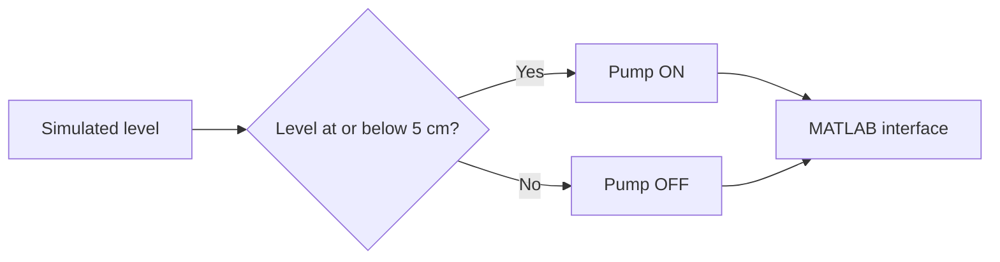

# Water Tank Level Monitoring and Simulation

**Process Control · Simulink · MATLAB UI**

A tank-level modeling project with a MATLAB monitoring interface and a Simulink model.

## Engineering highlights

- Simulink model of the water pump system.
- MATLAB app with start/stop monitoring and a one-second timer.
- Simulated level readings of 0–10 cm; pump ON at or below 5 cm.

## Monitoring logic

| Simulated input | Displayed pump state |
| --- | --- |
| 0–5 cm | ON |
| Above 5–10 cm | OFF |

The interface refreshes once per second while monitoring is enabled. These are software rules from the original application, not physical measurements.

## Project files

| File | Purpose |
| --- | --- |
| [Project Report.pdf](Project%20Report.pdf) | Engineering report (PDF) |
| [WaterLevelTank.mp4](WaterLevelTank.mp4) | Original demonstration video |
| [WaterPump.slx](WaterPump.slx) | Simulink model |
| [WaterPumpApp.m.txt](WaterPumpApp.m.txt) | MATLAB app source (text) |

## How to explore or reproduce

Open `WaterPump.slx` in MATLAB/Simulink. To try the separate monitoring interface, copy `WaterPumpApp.m.txt` to `WaterPumpApp.m` in a MATLAB working directory and execute `app = WaterPumpApp;`. Review the report and video for context.

## Scope and limitations

The UI generates random readings and is not connected to a physical sensor or the Simulink model. The simulation has not been rerun during this documentation update.

## Portfolio

[Hassan Ali Janjua — Engineering portfolio](https://github.com/HassanAliJanjua03)
